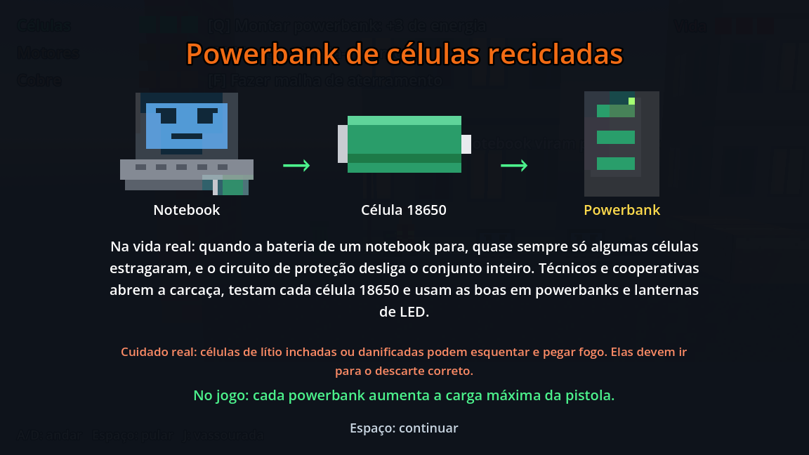

# Gari Adventures

Plataforma 2.5D feito na Godot, em que um gari reaproveita os próprios inimigos para ficar mais forte. Baterias de notebook viram powerbanks. Motores de micro-ondas viram uma pistola-dínamo. Fios usados viram cobre para uma malha de aterramento.

> Protótipo jogável com uma fase curta.


## Como rodar

Você precisa da **Godot 4.7, versão padrão**. A versão .NET não é necessária.

1. Instale a Godot pela [página oficial](https://godotengine.org/download/archive/4.7.2-stable/). No Windows, também dá para usar:

   ```powershell
   winget install --id GodotEngine.GodotEngine --exact
   ```

2. Baixe este repositório com `git clone` ou em **Code > Download ZIP**. Se baixar o ZIP, extraia a pasta.
3. Abra a Godot e clique em **Importar**.
4. Selecione o arquivo `project.godot` e confirme em **Importar e Editar**.
5. Espere a primeira importação terminar.
6. Aperte **F5** para jogar.

Na primeira abertura, é normal a Godot levar alguns instantes importando imagens e sons.

### Pela linha de comando

Com o executável da Godot disponível como `godot`, rode na pasta do projeto:

```bash
godot --headless --import
godot --path .
```

O primeiro comando só é necessário depois de baixar o projeto ou quando a arte e os sons mudarem.

## Controles

| Ação | Teclas |
|---|---|
| Andar | A/D ou setas |
| Pular | Espaço, W ou seta para cima |
| Vassourada | J ou X |
| Montar pistola-dínamo | R |
| Montar powerbank | Q |
| Fazer malha de aterramento | F |
| Atirar | K ou C |

## Como jogar

1. Derrote os notebooks com a vassoura e recolha as células de bateria.
2. Com 3 células, monte um powerbank. Você pode montar até 2, e cada um aumenta a carga da pistola.
3. Pule a faixa eletrificada. Derrote os micro-ondas usando caixas como escudo e suba a torre entre as ondas. Com 3 motores, monte a pistola-dínamo, que gera a própria carga aos poucos.
4. No abismo, derrube os micro-ondas de longe antes de pular pelas plataformas. Motores extras recarregam a pistola.
5. Atire através da cerca para derrotar o micro-ondas do outro lado.
6. Derrote os fios usados e, com 3 cobres, faça a malha de aterramento.
7. Atravesse o chão eletrificado com a malha. Ela leva a corrente até o gerador, que abre o portão do caminhão de lixo.

Você tem 3 pontos de vida. Encoste nos ecopontos verdes para recuperar a vida e marcar o local de retorno. Ao perder toda a vida, você volta ao último ecoponto sem perder o que coletou.

## Inimigos e reciclagem real

Cada inimigo é um tipo de lixo, e cada item segue um reaproveitamento que existe de verdade.

| Inimigo | Ataque | Deixa | Vira | Na vida real |
|---|---|---|---|---|
| Notebook | Contato | Célula 18650 | Powerbank | Células boas de baterias descartadas são testadas e reaproveitadas em powerbanks e lanternas |
| Micro-ondas | Atira ondas | Motor | Pistola-dínamo | O motor do prato funciona como gerador de manivela |
| Fios usados | Chicotada elétrica | Cobre | Malha de aterramento | O cobre é desencapado e reciclado muitas vezes sem perder qualidade |

Na primeira vez que você monta cada item, o jogo pausa e mostra como aquele material é reciclado de verdade, com um cuidado de segurança real.



As fontes de cada informação estão em [`cerebro/reciclagem.md`](cerebro/reciclagem.md).

## Organização

| Pasta | Conteúdo |
|---|---|
| `jogo/` | Cenas e scripts |
| `arte/` e `som/` | Arte e áudio gerados para o protótipo |
| `ferramentas/` | Gerador da arte e do áudio |
| `cerebro/` | Decisões, roadmap, notas do desenvolvimento e a reciclagem real de cada inimigo |
| `.claude/agents/` e `AGENTS.md` | Regras e agentes usados no desenvolvimento com Claude Code |
