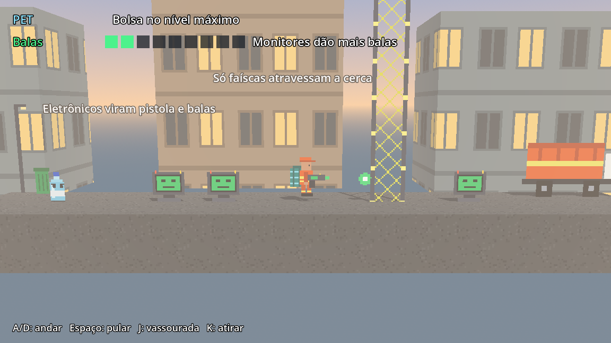

# Gari Adventures

Plataforma 2.5D feito na Godot, em que um gari reaproveita os próprios inimigos para ficar mais forte. Garrafas PET viram fio e bolsas. Lixo eletrônico vira pistola e balas.

> Protótipo jogável com uma fase curta. O nome é provisório.



## Como rodar

Você precisa da **Godot 4.7, versão padrão**. A versão .NET não é necessária.

1. Instale a Godot pela [página oficial](https://godotengine.org/download/archive/4.7.2-stable/). No Windows, também dá para usar:

   ```powershell
   winget install --id GodotEngine.GodotEngine --exact
   ```

2. Baixe este repositório com `git clone` ou em **Code > Download ZIP**. Se baixar o ZIP, extraia a pasta.
3. Abra a Godot e clique em **Importar**.
4. Selecione o arquivo `project.godot` e confirme em **Importar e Editar**.
5. Espere a primeira importação terminar.
6. Aperte **F5** para jogar.

Na primeira abertura, é normal a Godot levar alguns instantes importando imagens e sons.

### Pela linha de comando

Com o executável da Godot disponível como `godot`, rode na pasta do projeto:

```bash
godot --headless --import
godot --path .
```

O primeiro comando só é necessário depois de baixar o projeto ou quando a arte e os sons mudarem.

## Controles

| Ação | Teclas |
|---|---|
| Andar | A/D ou setas |
| Pular | Espaço, W ou seta para cima |
| Vassourada | J ou X |
| Fazer bolsa | E |
| Montar pistola | R |
| Atirar | K ou C |

## Como jogar

1. Derrote as garrafas com a vassoura e recolha o PET.
2. Com 3 PET, faça uma bolsa. Cada bolsa dá mais 3 espaços para componentes e balas.
3. Derrote os monitores quebrados e recolha os componentes.
4. Com 3 componentes, monte a pistola. Depois disso, cada componente é uma bala.
5. Atire através da cerca para derrotar o monitor do outro lado e chegue ao caminhão de lixo.

## Organização

| Pasta | Conteúdo |
|---|---|
| `jogo/` | Cenas e scripts |
| `arte/` e `som/` | Arte e áudio gerados para o protótipo |
| `ferramentas/` | Gerador da arte e do áudio |
| `cerebro/` | Decisões, roadmap e notas do desenvolvimento |
| `.claude/agents/` e `AGENTS.md` | Regras e agentes usados no desenvolvimento com Claude Code |
